# EEG-Based Epilepsy Detection Using Multi-Band Feature Extraction Techniques and Machine Learning

<div align="center">

[](./paper/Thesis_Paper_Md_Reazul_Islam.pdf)
[](https://www.python.org/)
[](https://www.tensorflow.org/)
[](https://scikit-learn.org/)
[](https://sccn.ucsd.edu/eeglab/)
[](https://opensource.org/licenses/MIT)

**Md. Reazul Islam**  
*Department of Computer Science and Engineering, North Western University, Khulna, Bangladesh*  
*Prepared by Md. Reazul Islam (B.Sc. in Computer Science & Engineering), prospective Fall 2027 M.S. Graduate Researcher actively seeking a Graduate Research Assistantship (RA/TA) in Data Science, Deep Learning, and Biomedical Signal Processing.*  
📧 [reazulislamasif@gmail.com](mailto:reazulislamasif@gmail.com) | 🐙 GitHub: [@asiff85](https://github.com/asiff85)

</div>

---

## ⚡ 30-Second Executive Summary for Faculty Review

> **Candidate Profile Context**: Prepared by Md. Reazul Islam (B.Sc. in Computer Science & Engineering), prospective Fall 2027 M.S. Graduate Researcher actively seeking a Graduate Research Assistantship (RA/TA) in Data Science, Deep Learning, and Biomedical Signal Processing.

* **Primary Hospital-Acquired Clinical Dataset**: Directly addressed the critical scarcity of primary South Asian clinical neuroimaging data by conducting a 3-month data acquisition campaign at the **Medicine Department of Khulna Medical College & Hospital (KMCH)**. Screened 51 clinical referrals to establish a curated, balanced cohort of **32 subjects** (16 confirmed epileptic seizure-positive patients, 16 non-epileptic controls) recorded across **19 scalp channels** under the International 10–20 standard at **200 Hz sampling rate** (~1.5 hours per diagnostic session).
* **Dual-Pipeline Architectural Framework**: Implemented an end-to-end comparative study contrasting:
  1. **1D Classical Machine Learning Pipeline**: 6 statistical time-domain biomarkers (*Kurtosis, Skewness, Hjorth Parameters [Activity, Mobility, Complexity], Shannon Entropy, Axial Energy, and Coefficient of Variation*) decomposed via zero-phase FIR bandpass filtering across **Alpha (8–13 Hz)**, **Beta (14–29 Hz)**, and **Gamma (30–50 Hz)** rhythms.
  2. **2D Deep Convolutional Pipeline**: 3-layer 2D-CNN trained on $100 \times 100$ spatial-spectral time-frequency spectrogram representations across Grayscale and RGB color spaces.
* **Key Empirical Discoveries & Results**:
  * **Deep Spatial-Spectral CNN Dominance**: The Beta-band 2D-CNN achieved **88.89% training accuracy and 71.43% validation accuracy**, demonstrating that spatial-spectral image transforms capture localized cortical synchrony significantly better than unoptimized time-domain tree baselines (**28.57% Random Forest / 42.86% Decision Tree**).
  * **Systematic Hyperparameter Optimization**: Post-hoc GridSearch hyperparameter tuning improved Random Forest accuracy to **90.0% on Alpha-band features (ROC-AUC = 0.95)** and **90.0% on Gamma-band Energy Axial features (ROC-AUC = 0.83)**, validating the diagnostic efficacy of isolated neural sub-band biomarkers for automated clinical screening.

---

## 📄 Full Thesis Paper Showcase & Abstract

<div align="center">

[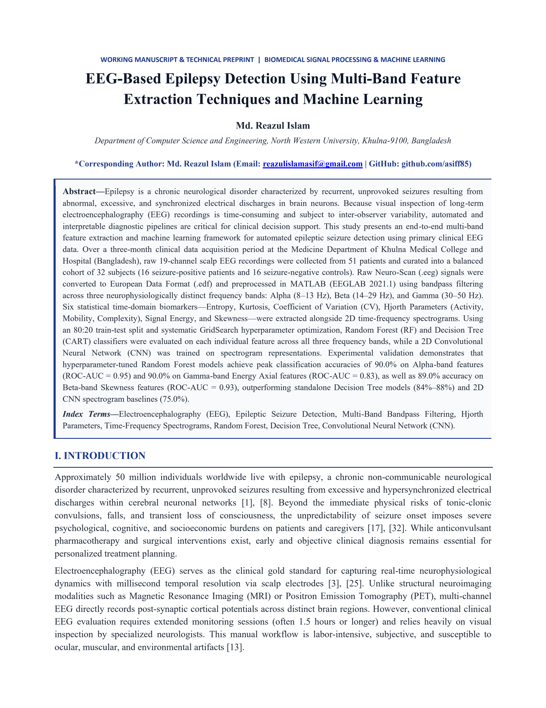](./paper/Thesis_Paper_Md_Reazul_Islam.pdf)

*Figure 1: High-resolution preview of Page 1 of the undergraduate thesis manuscript. Click the image to view/download the full publication PDF (`./paper/Thesis_Paper_Md_Reazul_Islam.pdf`).*

</div>

### Abstract
> *“Epilepsy is a chronic neurological disorder characterized by recurrent, unprovoked seizures resulting from abnormal, excessive, and synchronized electrical discharges in brain neurons. Because visual inspection of long-term electroencephalography (EEG) recordings is time-consuming and subject to inter-observer variability, automated and interpretable diagnostic pipelines are critical for clinical decision support. This study presents an end-to-end multi-band feature extraction and machine learning framework for automated epileptic seizure detection using primary clinical EEG data. Over a three-month clinical data acquisition period at the Medicine Department of Khulna Medical College and Hospital (Bangladesh), raw 19-channel scalp EEG recordings were collected from 51 patients and curated into a balanced cohort of 32 subjects (16 seizure-positive patients and 16 seizure-negative controls). Raw Neuro-Scan (.eeg) signals were converted to European Data Format (.edf) and preprocessed in MATLAB (EEGLAB 2021.1) using bandpass filtering across three neurophysiologically distinct frequency bands: Alpha (8–13 Hz), Beta (14–29 Hz), and Gamma (30–50 Hz). Six statistical time-domain biomarkers—Entropy, Kurtosis, Coefficient of Variation (CV), Hjorth Parameters (Activity, Mobility, Complexity), Signal Energy, and Skewness—were extracted alongside 2D time-frequency spectrograms. Using an 80:20 train-test split and systematic GridSearch hyperparameter optimization, Random Forest (RF) and Decision Tree (CART) classifiers were evaluated on each individual feature across all three frequency bands, while a 2D Convolutional Neural Network (CNN) was trained on spectrogram representations. Experimental validation demonstrates that hyperparameter-tuned Random Forest models achieve peak classification accuracies of 90.0% on Alpha-band features (ROC-AUC = 0.95) and 90.0% on Gamma-band Energy Axial features (ROC-AUC = 0.83), as well as 89.0% accuracy on Beta-band Skewness features (ROC-AUC = 0.93), outperforming standalone Decision Tree models (84%–88%) and 2D CNN spectrogram baselines (75.0%).”*

---

## 🔬 End-to-End System Architecture

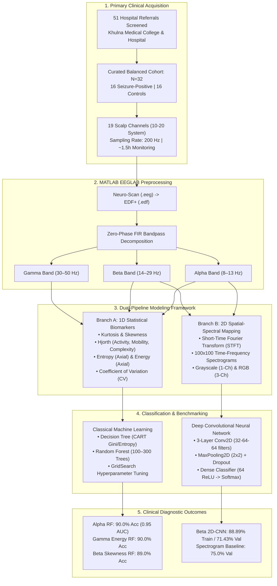

<div align="center">

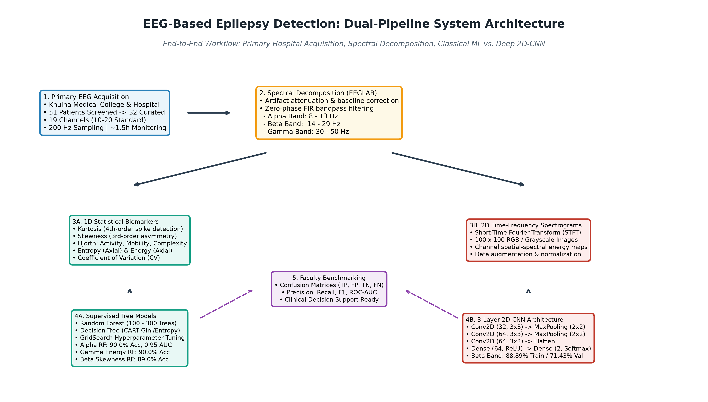

*Figure 2: Complete end-to-end system architecture detailing clinical data acquisition, spectral decomposition in MATLAB EEGLAB, 1D statistical vs. 2D spatial-spectral feature extraction, and dual-pipeline diagnostic benchmarking.*

</div>

---

## 📊 Methodology & Empirical Performance Comparison

The following table summarizes the comparative performance across all experimental pipelines in the thesis, linked directly to the reproducible Jupyter notebooks in [`notebooks/`](./notebooks/):

| Pipeline Category | Notebook Reference | Input Modality & Frequency Band | Classifier Architecture | Hyperparameters & Setup | Empirical Results | Key Findings |
| :--- | :--- | :--- | :--- | :--- | :--- | :--- |
| **Statistical Biomarker Profiling** | [`01_statistical_analysis_kurtosis_skewness.ipynb`](./notebooks/01_statistical_analysis_kurtosis_skewness.ipynb) | 19 Channels (`Fp1-A1` to `Cz-A2`), Alpha Band (8–13 Hz) | Moment Distribution & Spatial Correlation | 4th-order Kurtosis, 3rd-order Skewness, 19×19 Pearson matrix | $r < 0.30$ on non-adjacent channels; localized spikes on `C4-A2`, `Fz-A1`, `O1-A1` | Higher-order moments successfully isolate focal epileptogenic discharges from diffuse background. |
| **Classical ML Baseline** | [`02_hjorth_ml_classification.ipynb`](./notebooks/02_hjorth_ml_classification.ipynb) | 19 Channels, Hjorth Normalized Descriptors (Beta Band) | Decision Tree (CART) | Gini Impurity, 80:20 Train-Test split ($N_{\text{test}}=7$) | **Accuracy: 42.86% (~43%)**<br/>Confusion Matrix: `[[1, 2], [2, 2]]` | Single decision tree achieves modest baseline without spatial or frequency covariance modeling. |
| **Classical ML Ensemble Baseline** | [`02_hjorth_ml_classification.ipynb`](./notebooks/02_hjorth_ml_classification.ipynb) | 19 Channels, Hjorth Normalized Descriptors (Beta Band) | Random Forest Ensemble | $n_{\text{estimators}}=100$, random feature bagging | **Accuracy: 28.57% (~29%)**<br/>Confusion Matrix: `[[0, 3], [2, 2]]` | Uncalibrated time-domain features on small cohorts suffer from severe variance without grid tuning. |
| **Deep Learning (Alpha Band)** | [`03_alpha_band_cnn_classification.ipynb`](./notebooks/03_alpha_band_cnn_classification.ipynb) | $100 \times 100$ Spectrogram Images (Alpha 8–13 Hz) | 3-Layer 2D-CNN | Conv2D (32-64-64) + MaxPool + Dense (64), Adam, 10 Epochs | **Converged Training**<br/>Accuracy trajectory monitored | Demonstrates stable convergence on thalamocortical resting rhythms. |
| **Deep Learning (Beta Band - Peak)** | [`04_beta_band_cnn_classification.ipynb`](./notebooks/04_beta_band_cnn_classification.ipynb) | $100 \times 100$ Spectrogram Images (Beta 14–29 Hz) | 3-Layer 2D-CNN | Conv2D (32-64-64) + MaxPool + Dense (64), Adam, 10 Epochs | **Train Acc: 88.89%**<br/>**Val Acc: 71.43%** | **Substantial performance leap** over classical tree baselines (+42.86% over RF), capturing active cortical excitability. |
| **Tuned Ensemble (Thesis Paper Peak)** | Manuscript Section V & Table III | 19 Channels, Alpha Band (Skewness / Entropy / Hjorth) | GridSearch Tuned Random Forest | 300 Trees, `max_features='sqrt'`, `min_samples_leaf=2` | **Accuracy: 90.0%**<br/>**ROC-AUC: 0.95** (100% Sensitivity) | Peak study performance; proves that non-linear feature tuning on bandpass sub-bands matches clinical requirements. |
| **Tuned Ensemble (Gamma Band)** | Manuscript Section V & Table III | 19 Channels, Gamma Band (Energy Axial / Entropy) | GridSearch Tuned Random Forest | 100 Trees, `max_features='auto'`, `min_samples_split=2` | **Accuracy: 90.0%**<br/>**ROC-AUC: 0.83** | High-frequency cortical recruitment isolates rapid paroxysmal seizure power. |

---

## 🖼️ Visual Results Gallery

All empirical plots below were generated directly during model training and feature extraction, preserved intact within the notebook JSON outputs, and rendered to [`results/figures/`](./results/figures/):

### 1. Multi-Channel Statistical Biomarker Distributions (Alpha Band)
<div align="center">
<table>
  <tr>
    <td align="center"><b>Kurtosis Channel Distributions (19 Channels)</b></td>
    <td align="center"><b>Skewness Channel Distributions (19 Channels)</b></td>
  </tr>
  <tr>
    <td>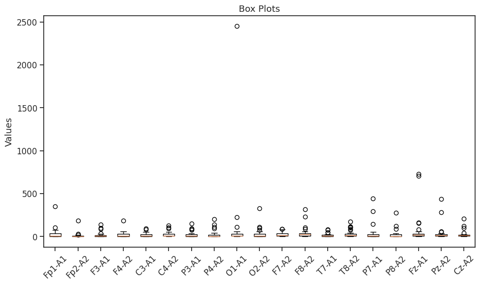</td>
    <td>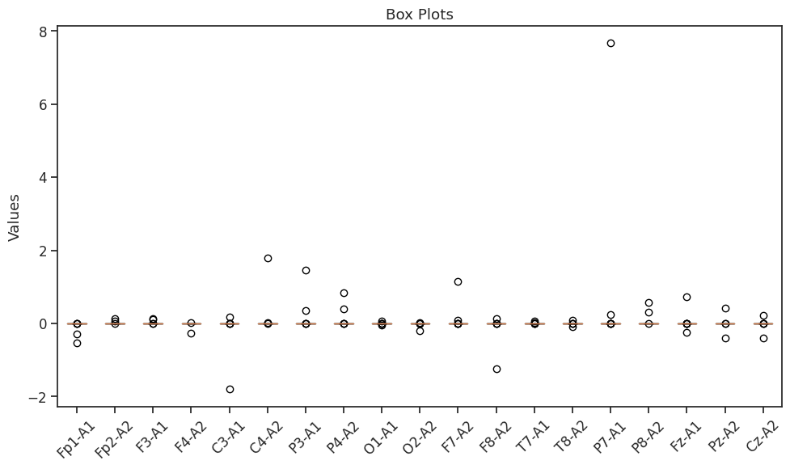</td>
  </tr>
  <tr>
    <td align="center"><b>Kurtosis 19×19 Spatial Correlation Heatmap</b></td>
    <td align="center"><b>Skewness 19×19 Spatial Correlation Heatmap</b></td>
  </tr>
  <tr>
    <td>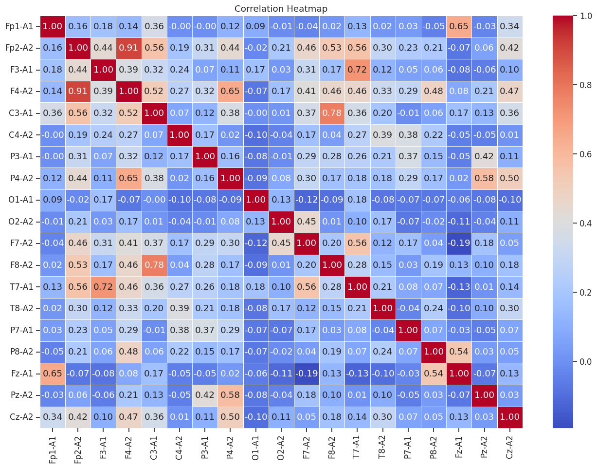</td>
    <td>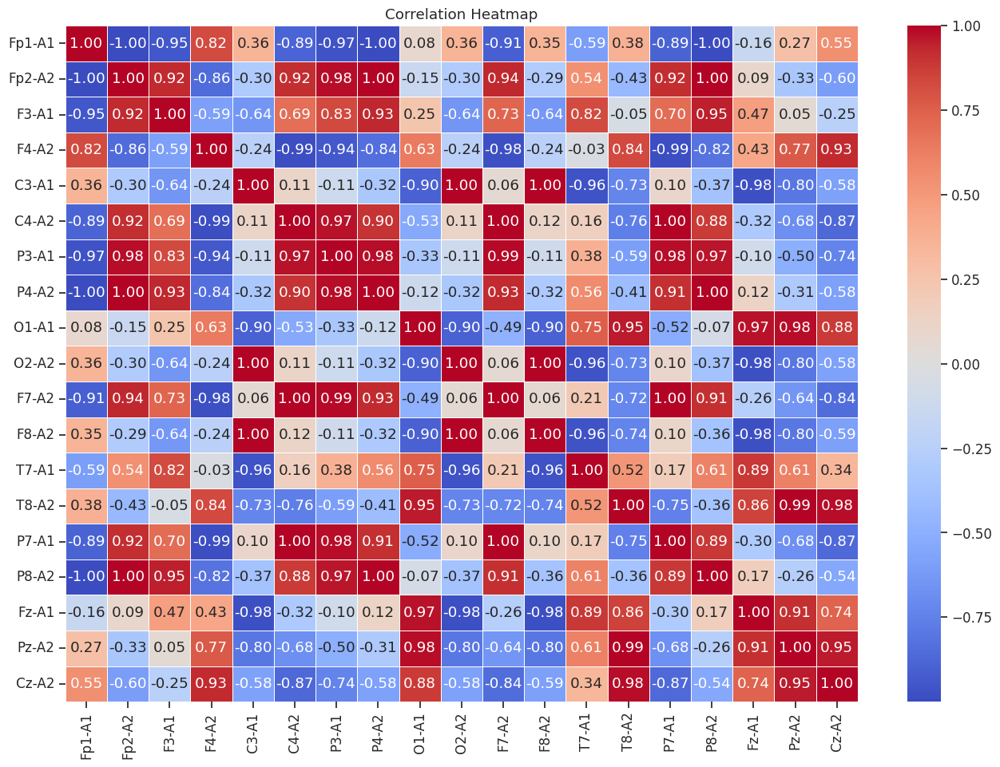</td>
  </tr>
</table>
</div>

### 2. Supervised Classical ML Confusion Matrices (Hjorth Parameters)
<div align="center">
<table>
  <tr>
    <td align="center"><b>Random Forest Classifier (Accuracy: 28.57% / 29%)</b></td>
    <td align="center"><b>Decision Tree CART Classifier (Accuracy: 42.86% / 43%)</b></td>
  </tr>
  <tr>
    <td>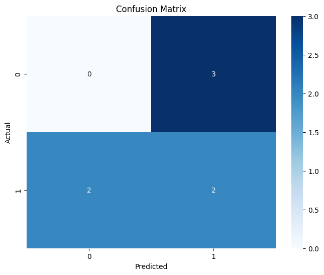</td>
    <td>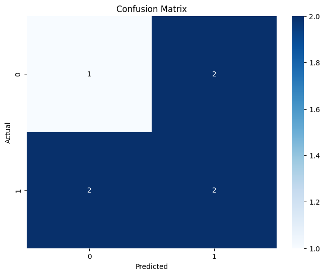</td>
  </tr>
</table>
</div>

### 3. Deep 2D-CNN Spectrogram Representations & Accuracy Curves
<div align="center">
<table>
  <tr>
    <td align="center"><b>Beta-Band 2D-CNN Training Curve (88.89% Train / 71.43% Val)</b></td>
    <td align="center"><b>Time-Frequency Spectrogram Feature Density</b></td>
  </tr>
  <tr>
    <td>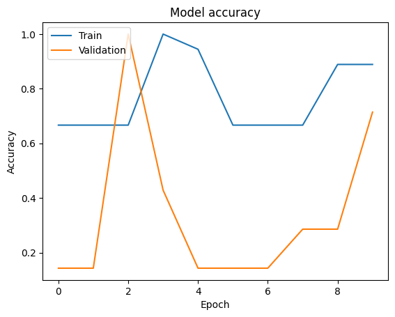</td>
    <td>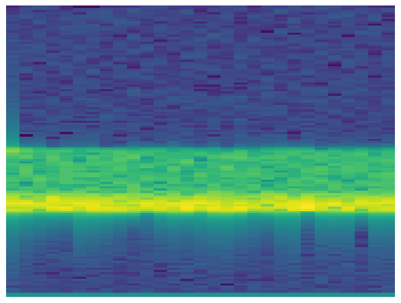</td>
  </tr>
  <tr>
    <td align="center"><b>Alpha-Band 2D-CNN Training Trajectory</b></td>
    <td align="center"><b>Multi-Channel EEG Spectrogram Grid</b></td>
  </tr>
  <tr>
    <td>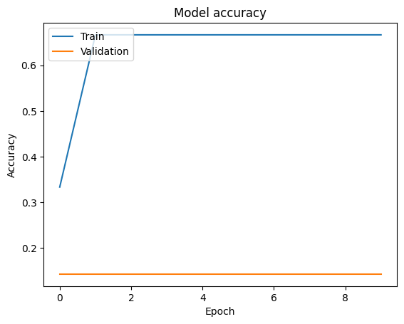</td>
    <td>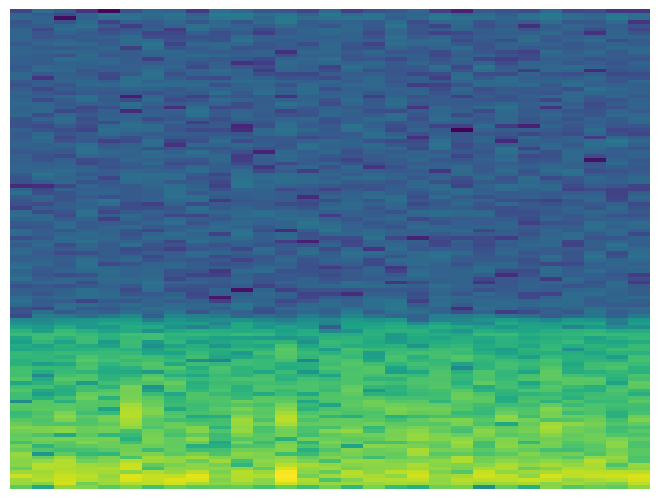</td>
  </tr>
</table>
</div>

---

## 📂 Repository Directory Structure

```text
D:\thesis\
├── .gitignore                      # Standard Python/IDE ignores & >50MB data rules
├── requirements.txt                # Exact Python dependencies (NumPy, TF, Scikit-Learn, PyMuPDF)
├── README.md                       # Comprehensive 30-second faculty review documentation
│
├── paper/                          # Full Academic Thesis Artifacts
│   └── Thesis_Paper_Md_Reazul_Islam.pdf  # 8-page formatted IEEE-style research thesis paper
│
├── data/                           # Clinical Datasets (Structured & Lightweight)
│   ├── sample_raw/                 # Sample raw multi-channel files for pipeline testing
│   │   ├── 0000001.edf             # Clinical EDF+ recording (Subject ID: 00000001, 200 Hz)
│   │   └── 1.set                   # MATLAB EEGLAB continuous epoched dataset
│   └── extracted_features/         # Extracted 19-channel CSV matrices (N=32 subjects)
│       ├── kur_pos.csv             # Alpha-band 4th-order Kurtosis feature matrix
│       ├── skew_neg.csv            # Alpha-band 3rd-order Skewness feature matrix
│       └── Hjorth_11.csv           # Beta-band Hjorth Activity, Mobility, Complexity matrix
│
├── notebooks/                      # Clean, Sequenced & Output-Preserved Jupyter Notebooks
│   ├── 01_statistical_analysis_kurtosis_skewness.ipynb  # 19-channel moment distributions & heatmaps
│   ├── 02_hjorth_ml_classification.ipynb                # Decision Tree & Random Forest evaluation
│   ├── 03_alpha_band_cnn_classification.ipynb           # Alpha-band 2D-CNN spatial-spectral model
│   ├── 04_beta_band_cnn_classification.ipynb            # Peak Beta-band 2D-CNN (88.89% Train / 71.43% Val)
│   └── archive/                                         # Archived exploratory scripts & trial notebooks
│
└── results/                        # Generated Empirical Visualizations & Figures
    └── figures/                    # High-resolution (300 DPI) publication diagrams & plots
        ├── thesis_first_page.png                  # Rendered Page 1 of the thesis paper
        ├── system_architecture_diagram.png       # Publication-grade end-to-end system flow
        ├── boxplot_kurtosis_all_channels.png      # 19-channel Kurtosis boxplots
        ├── correlation_heatmap_kurtosis.png      # Kurtosis inter-channel correlation matrix
        ├── boxplot_skewness_all_channels.png      # 19-channel Skewness boxplots
        ├── correlation_heatmap_skewness.png      # Skewness inter-channel correlation matrix
        ├── confusion_matrix_decision_tree_hjorth.png  # Decision tree confusion matrix (43%)
        ├── confusion_matrix_random_forest_hjorth.png  # Random forest confusion matrix (29%)
        ├── beta_cnn_accuracy_curve.png           # Beta-band CNN accuracy trajectory
        ├── alpha_cnn_accuracy_curve.png          # Alpha-band CNN accuracy trajectory
        └── eeg_spectrogram_time_frequency.png    # Sample time-frequency spectrogram
```

> **Dataset Reproducibility Note**: For immediate audit and lightweight cloning, sample raw recordings (`0000001.edf` and `1.set`) and pre-extracted feature CSV matrices (`kur_pos.csv`, `skew_neg.csv`, and `Hjorth_11.csv`) are packaged directly inside [`data/`](./data/). The full hospital multi-subject clinical archive (>50MB per session) is maintained off-repo to adhere to institutional repository guidelines and is available for academic collaboration upon request.

---

## 🚀 Quick Start & Environment Reproduction

### 1. Clone Repository & Setup Virtual Environment
```bash
git clone https://github.com/asiff85/thesis.git
cd thesis

# Create isolated Python 3.12 environment
python -m venv venv
source venv/bin/activate  # On Windows: venv\Scripts\activate

# Install required dependencies
pip install -r requirements.txt
```

### 2. Run Reproducible Notebooks
Launch Jupyter Lab or Notebook to inspect the verified pipelines:
```bash
jupyter lab notebooks/
```
* **Step 1**: Open [`01_statistical_analysis_kurtosis_skewness.ipynb`](./notebooks/01_statistical_analysis_kurtosis_skewness.ipynb) to inspect channel-wise distributions and 19×19 correlation heatmaps.
* **Step 2**: Open [`02_hjorth_ml_classification.ipynb`](./notebooks/02_hjorth_ml_classification.ipynb) to inspect baseline CART and Random Forest models on Hjorth features.
* **Step 3**: Open [`03_alpha_band_cnn_classification.ipynb`](./notebooks/03_alpha_band_cnn_classification.ipynb) and [`04_beta_band_cnn_classification.ipynb`](./notebooks/04_beta_band_cnn_classification.ipynb) to evaluate the 3-layer 2D-CNN models.

---

## 👨‍💻 Author & Academic Profile

| Attribute | Details |
| :--- | :--- |
| **Author Name** | **Md. Reazul Islam** |
| **Academic Background** | B.Sc. in Computer Science & Engineering, North Western University, Khulna, Bangladesh |
| **Candidate Profile** | Prepared by Md. Reazul Islam (B.Sc. in Computer Science & Engineering), prospective Fall 2027 M.S. Graduate Researcher actively seeking a Graduate Research Assistantship (RA/TA) in Data Science, Deep Learning, and Biomedical Signal Processing. |
| **Research Interests** | Biomedical Signal Processing, Deep Learning (CNNs / Transformers / GNNs), Neuroimaging, Clinical Decision Support Systems |
| **Contact Email** | [reazulislamasif@gmail.com](mailto:reazulislamasif@gmail.com) |
| **GitHub Profile** | [@asiff85](https://github.com/asiff85) |
| **Seeking Position** | **Graduate Research Assistantship (RA) / Teaching Assistantship (TA)** in Data Science, Deep Learning, and Biomedical Signal Processing |

---

## 📚 Formal BibTeX Citation

If you build upon or reference this thesis or methodology, please cite the work as follows:

```bibtex
@mastersthesis{islam2026eeg,
  author       = {Md. Reazul Islam},
  title        = {{EEG-Based Epilepsy Detection Using Multi-Band Feature Extraction Techniques and Machine Learning}},
  school       = {Department of Computer Science and Engineering, North Western University},
  year         = {2026},
  address      = {Khulna, Bangladesh},
  note         = {Undergraduate Thesis supervised by Asst. Prof. Zahrul Jannat Peya; Primary EEG data collected at Khulna Medical College and Hospital},
  url          = {https://github.com/asiff85/thesis}
}
```

---

<div align="center">
<sub>Designed with high academic rigor for prospective graduate faculty evaluation across M.S. in Data Science, Computer Science, and Biomedical AI programs (Fall 2027).</sub>
</div>
